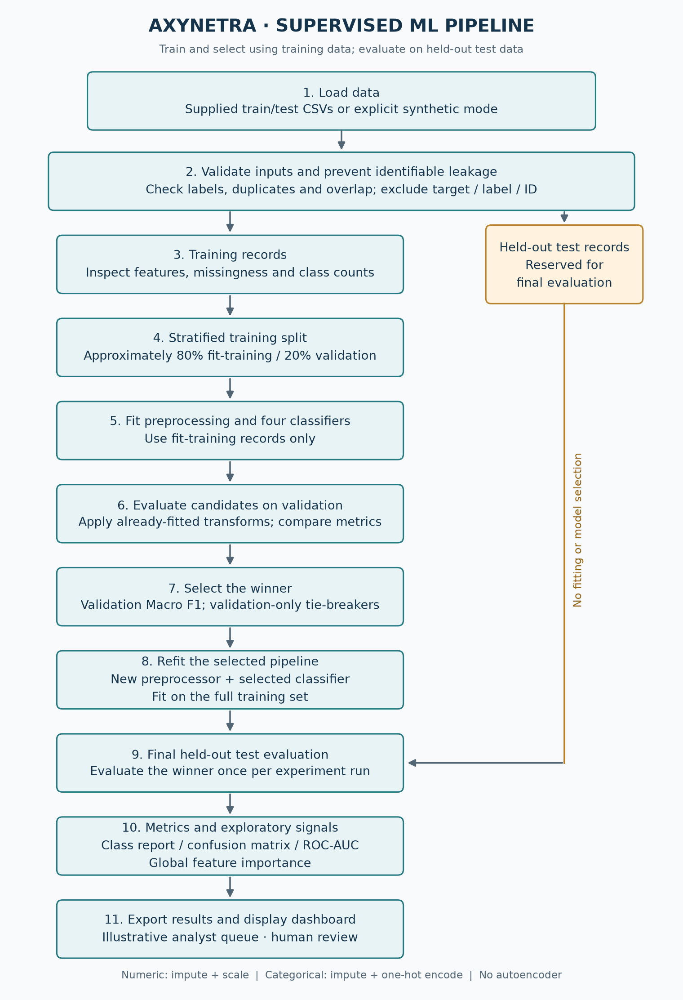
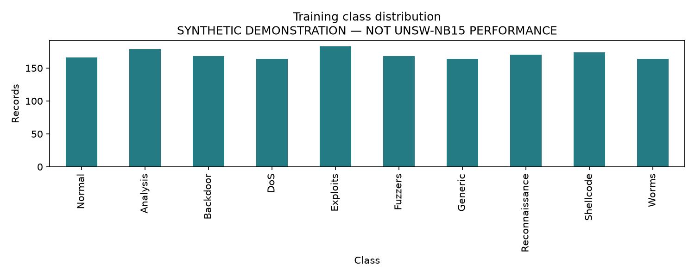
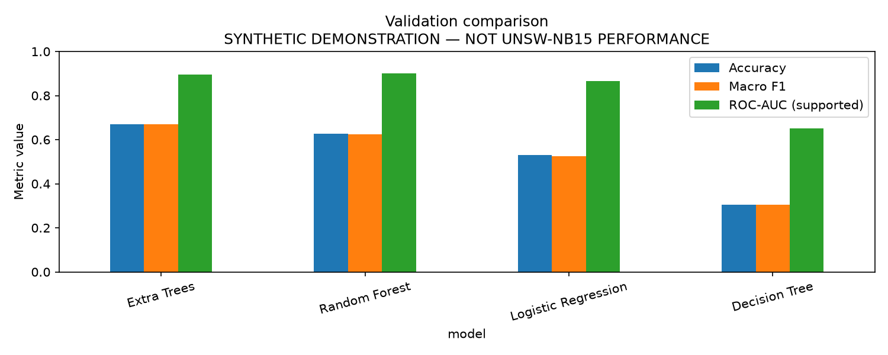
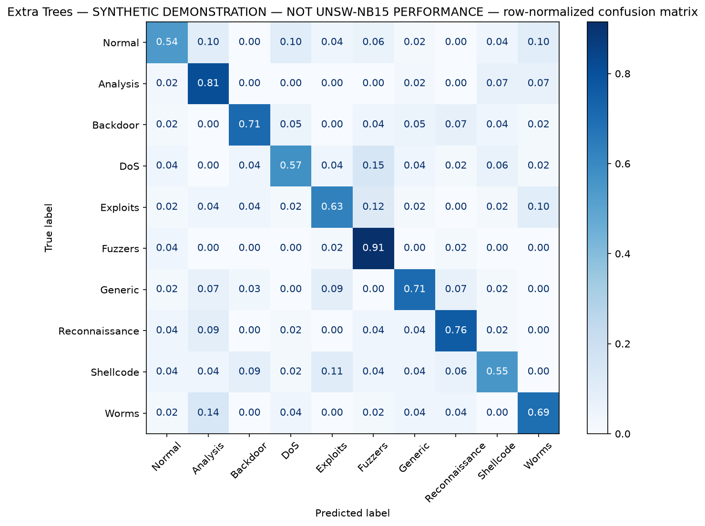
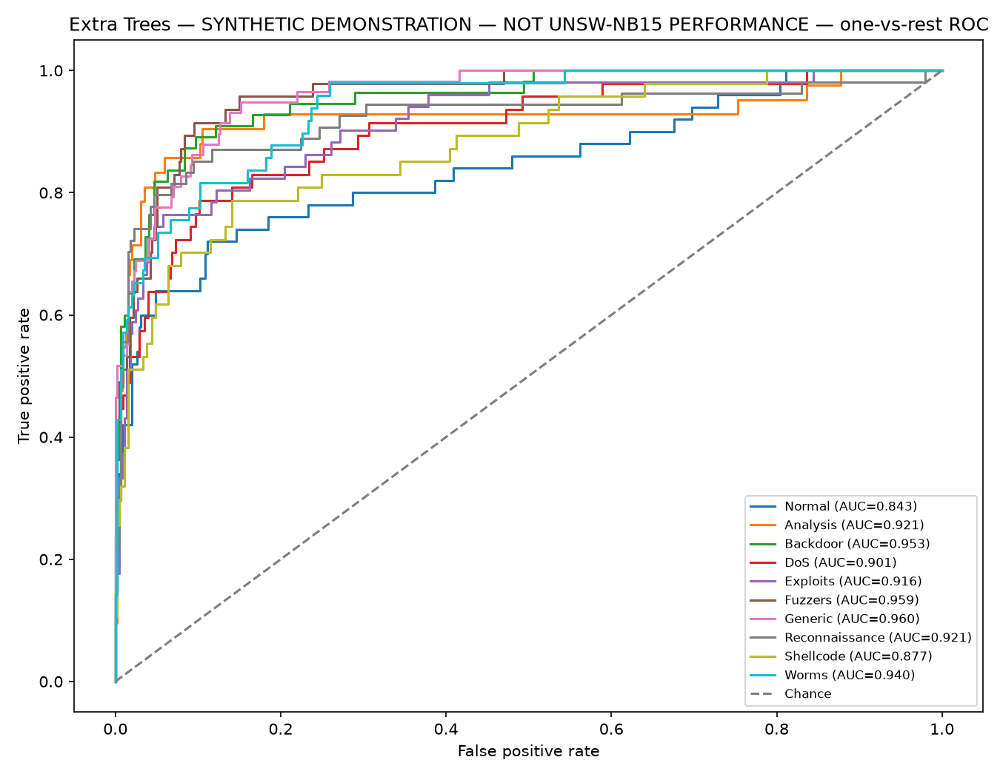

# Axynetra

**Explainable Network Threat Classification & Intelligent Alert Triage**

[Open the complete ML notebook](Axynetra_ML_Workflow.ipynb) · [Read its Python source](Axynetra_ML_Workflow.py) · [Command-line pipeline](multiclass_intrusion.py)

Axynetra is a supervised machine-learning project for **CSMA Option 4: Multi-Class Attack Classification**, designed for the UNSW-NB15 dataset. It predicts **Normal** traffic or one of nine attack categories: Analysis, Backdoor, DoS, Exploits, Fuzzers, Generic, Reconnaissance, Shellcode and Worms.

The repository provides an academic notebook, a command-line experiment runner, a Streamlit dashboard and a PDF-report generator. It analyses saved network-flow CSV records. It does not capture packets or block traffic. **Autoencoders are not implemented.**

> **Current evidence:** the saved notebook and images in this README use reproducible **synthetic demonstration data**, not real UNSW-NB15 records. They verify the pipeline and illustrate its outputs. Real-dataset results remain pending; do not report these numbers as cybersecurity benchmark performance.

## Start with the notebook

Open the project folder in **VS Code**, install Microsoft's Python and Jupyter extensions, then:

```powershell
cd "D:\Axynetra"
.\.venv\Scripts\python.exe -m pip install -r requirements-notebook.txt
```

Open **`Axynetra_ML_Workflow.ipynb`**, select **Select Kernel → Python Environments → `.venv\Scripts\python.exe`**, then **Run All**. Existing saved outputs can also be read on GitHub without running Python.

If starting from a new checkout, first create an isolated environment using `py -m venv .venv`. The local environment was tested with Python 3.14.6. `requirements-lock.txt` records the reviewed full development environment; install it for those exact dependency versions.

`Axynetra_ML_Workflow.py` contains the same cells in **percent format** (`# %%` and `# %% [markdown]`). VS Code can run them individually with **Run Cell**. It imports tested helpers from `multiclass_intrusion.py`; keep both files in the project folder. The notebook shows model training explicitly rather than calling the whole command-line runner as one hidden step.

To rebuild and execute the notebook after changing its Python source:

```powershell
.\.venv\Scripts\python.exe tools/build_notebook.py --execute
```

Running the builder without `--execute` generates a clean notebook without saved outputs. The builder uses the current Python environment and puts temporary kernel resources in the project's ignored `.temp/` directory.
After executing in synthetic mode, `python tools/update_demo_docs.py` refreshes the public README tables and charts. It refuses runs marked as real data.

## The ML pipeline

[](docs/pipeline/axynetra_ml_pipeline.png)

[Open full-size diagram](docs/pipeline/axynetra_ml_pipeline.png) · [Scalable SVG](docs/pipeline/axynetra_ml_pipeline.svg)

**Training path:** training EDA → stratified fit/validation split → fit preprocessing and four classifiers → validation comparison → select winner → refit on full training data.

**Test path:** hold the test data aside → evaluate the refitted winner → generate metrics, charts and illustrative review items. Test scores never select the model.

The diagram is a static image so its labels stay visible in GitHub and narrow README previews. Regenerate it with `python tools/draw_pipeline.py`.

### What each stage produces

| Notebook stage | What happens | Visible output |
| --- | --- | --- |
| 1. Imports | Load libraries and record versions/seed | Version table, seed 42, ten categories |
| 2. Data loading | Explicit synthetic mode or user-supplied train/test CSVs | Data-source warning, split sizes and source fingerprints for real files |
| 3. Training EDA | Inspect training records, types, missingness and imbalance | First five rows, schema, numeric statistics, class-count table and chart |
| 4. Input checks | Reject invalid labels, infinite values, duplicate/overlapping records | Predictor count/list and passed checks, or an actionable error |
| 5. Training split | Create an approximately 80/20 stratified fit/validation split | Sizes, class coverage and singleton-class fallback notes |
| 6. Preprocessing | Define per-model transforms and classifiers | Preprocessor structure and four estimator configurations |
| 7. Candidate training | Fit each candidate and evaluate on validation only | Four-model leaderboard with precision, recall, F1, accuracy and ROC-AUC; comparison chart |
| 8. Selection/refit | Choose by validation Macro F1; refit winner on all training data | Selected model name and fitted pipeline |
| 9. Held-out evaluation | Evaluate the winner in one final stage per run | Final metrics, class report and per-class AUC/coverage |
| 10. Evaluation charts | Plot errors and probability-ranking performance | Row-normalized confusion matrix and one-vs-rest ROC curves |
| 11. Feature signals | Inspect tree impurity importances | Top features, plot and explicitly identified source model |
| 12. Alert queue | Combine predictions with illustrative severity weights | Ten-row preview of up to 100 prioritized review items |
| 13. Export | Save results and write completion metadata last | Artifact names/sizes, provenance and a final run summary |
| 14. Interpretation | Explain uses, assumptions and next experiments | Limitations, use cases and references |

### Preprocessing and selection rules

- Numeric features: **median imputation → StandardScaler**.
- Categorical features: **most-frequent imputation → OneHotEncoder**, handling unseen categories.
- Each candidate's preprocessor fits only on fit-training records. After selection, a new winning pipeline fits on all training records.
- Models: **Decision Tree, Random Forest, Extra Trees and Logistic Regression**, with class weighting.
- Selection: highest **validation Macro F1**; validation weighted F1 and accuracy break ties. Test scores do not select the model.
- Stratification preserves at least one fit and one validation record per class with two or more examples. Singleton classes stay in fit-training and are recorded; exact percentages vary with rounding.
- Missing/unknown targets are rejected rather than guessed as Normal. `attack_cat`, binary `label`, row `id` and ambiguous duplicate headers cannot enter predictors.
- Exact duplicate training predictors and train/test overlaps are rejected. Investigate them before altering benchmark splits; these checks do not rule out every possible form of leakage.

## Demonstration outputs

The following values come from the executed synthetic notebook, seed 42. Synthetic `feature_XX` columns are generated examples, not actual UNSW-NB15 feature names.

<!-- BEGIN SYNTHETIC SUMMARY -->
| Demonstration output | Observed value |
| --- | --- |
| Training rows | 1700 |
| Fit-training rows | 1358 |
| Validation rows | 342 |
| Held-out test rows | 500 |
| Predictors after exclusions | 24 |
| Validation-selected winner | Extra Trees |
| Held-out accuracy | 0.6880 |
| Held-out Macro F1 | 0.6828 |
| Held-out one-vs-rest macro ROC-AUC | 0.9192 |
| Defined AUC classes | 10/10 |

**Validation results — synthetic demonstration**

| Model | Accuracy | Macro F1 | Macro ROC-AUC |
| --- | ---: | ---: | ---: |
| Extra Trees | 0.6696 | 0.6695 | 0.8943 |
| Random Forest | 0.6257 | 0.6246 | 0.9020 |
| Logistic Regression | 0.5292 | 0.5254 | 0.8646 |
| Decision Tree | 0.3041 | 0.3057 | 0.6517 |

**Example review queue — synthetic demonstration**

| Flow index | Predicted category | Uncalibrated score | Illustrative priority |
| --- | --- | ---: | ---: |
| 112 | Shellcode | 0.6249 | 3.1245 |
| 351 | Shellcode | 0.5778 | 2.889 |
| 136 | Shellcode | 0.5759 | 2.8795 |
<!-- END SYNTHETIC SUMMARY -->

**Training-data class distribution — synthetic demonstration**



**Validation comparison — synthetic demonstration**



**Winner's held-out confusion matrix — synthetic demonstration**



**Winner's held-out ROC curves — synthetic demonstration**



These four public images were exported from the synthetic run. The notebook additionally shows feature-importance and queue outputs. Real/private runs should have notebook outputs cleared before publication because EDA previews and metadata can expose records or source details. Raw datasets and generated result directories are ignored by Git, but **saved notebook outputs are versioned**.

## Metrics and how to read them

| Metric/output | Meaning |
| --- | --- |
| Accuracy | Fraction of all records classified correctly; frequent classes can dominate |
| Macro precision/recall/F1 | Equal contribution from all ten categories, with zero for unsupported categories |
| Weighted F1 | Per-class F1 weighted by observed support |
| Class report | Precision, recall, F1 and support for each class |
| Normalized confusion matrix | Each row shows where a true class's records were assigned |
| One-vs-rest ROC-AUC | How well probability scores rank each class against all others |

`roc_auc_ovr_macro` requires all ten class AUCs to be defined. If a split lacks positives, negatives or a learned class, its AUC is undefined. `roc_auc_ovr_macro_supported` is a separate mean over defined classes, accompanied by `roc_auc_defined_classes` and `roc_auc_total_classes`. Do not present that subset average as full ten-class AUC. AUC uses aligned `predict_proba` columns, not predicted class labels.

Global impurity importance is associative, not causal, and can favour high-cardinality features. If Logistic Regression wins, importance comes from the highest-ranked validation tree model and is labelled accordingly. The maximum class score is uncalibrated; illustrative priority = score × a hand-assigned severity weight. Numeric deviations describe differences from training statistics, not causal explanations of individual alerts.

## Output files

The CLI writes to **`outputs/`** by default. The notebook writes separately to **`outputs/notebook/`** so it does not overwrite a previous CLI experiment.

| File | Contents |
| --- | --- |
| `validation_leaderboard.csv`, `model_comparison.csv` | Four candidates' validation metrics and selection flag |
| `validation_roc_auc.csv` | Per-class validation AUC and coverage for every candidate |
| `heldout_test_metrics.csv` | Winner's final test metrics |
| `heldout_test_roc_auc.csv` | Per-class held-out AUC, support and undefined reasons |
| `classification_report.txt` | Held-out classification report |
| `confusion_matrix.png`, `roc_curves.png` | Final evaluation figures |
| `feature_importance.csv`, `feature_importance.png` | Global tree feature signals and model identity |
| `example_soc_alerts.csv` | Up to 100 illustrative human-review items |
| `run_metadata.json` | Run type, split counts, selected model and evaluation details; written last |
| `training_class_distribution.png`, `validation_comparison.png` | Additional notebook EDA/comparison figures |

The notebook's metadata also records package versions, seed and supplied-file fingerprints. A valid completion marker is required by the dashboard. Use a separate output folder for each concurrent experiment.

## Run from PowerShell

```powershell
cd "D:\Axynetra"
.\.venv\Scripts\python.exe multiclass_intrusion.py --smoke-test --output outputs
.\.venv\Scripts\python.exe -m streamlit run dashboard.py
```

Open **http://localhost:8501**. Stop with **Ctrl+C**. To view notebook results in the dashboard from the project root:

```powershell
.\.venv\Scripts\python.exe -m streamlit run dashboard.py -- --results outputs/notebook
```

## Use the real UNSW-NB15 dataset

Download the official pre-split files from [UNSW Canberra](https://research.unsw.edu.au/projects/unsw-nb15-dataset) and put them in `data/`:

- `UNSW_NB15_training-set.csv` — published full split: 175,341 records.
- `UNSW_NB15_testing-set.csv` — published full split: 82,332 records.

For the notebook, set `SMOKE_TEST=False`. Its initial 50,000/20,000 row limits enable a smaller experiment; set both to zero for the full supplied split. Missing files cause an error instead of silently switching to synthetic data. CSV origin is not authenticated by the application; source fingerprints identify files without proving their origin.

CLI example using the full split:

```powershell
.\.venv\Scripts\python.exe multiclass_intrusion.py --train data/UNSW_NB15_training-set.csv --test data/UNSW_NB15_testing-set.csv --max-train 0 --max-test 0 --output outputs
```

To regenerate the academic report from **CLI results in `outputs/`**:

```powershell
.\.venv\Scripts\python.exe create_report.py --srn YOUR_SRN
```

Changing the notebook output directory does not automatically change the report generator's input. Existing PDFs may predate current code; regenerate before submission.

## Use cases

- **ML coursework and viva:** follow each cell from loading to conclusions; explain why validation and test data are separate.
- **Offline attack-category research:** compare supervised models on labelled flows with a documented dataset and evaluation protocol.
- **Rare-attack analysis:** inspect class-specific recall and confusion for Worms/Shellcode rather than relying on overall accuracy.
- **Analyst workflow demonstration:** illustrate category-based prioritization and human-review queues using stored records.
- **Reproducibility exercises:** compare the notebook and CLI under the same seed, versions and data source.

Axynetra has not been validated for live monitoring, automated response or production deployment. Domain shift, imbalance, duplicate/related flows and uncalibrated model scores require further study. An autoencoder is a possible future extension, not an implemented feature.

## Testing and publication

```powershell
.\.venv\Scripts\python.exe -m pytest -q
.\.venv\Scripts\python.exe tools/build_notebook.py --execute
.\.venv\Scripts\python.exe -m pip check
```

GitHub Actions runs unit/regression tests and executes the synthetic notebook. Unit tests cover leakage guards, filtering, sampling and ROC-AUC correctness, including undefined classes and reordered probability columns. Notebook execution checks the complete educational workflow. These do not measure real-data effectiveness.

Dependencies are pinned; `requirements-notebook.txt` adds notebook execution dependencies to the normal development requirements. The full lock includes audit tooling; `python -m pip_audit` checks current known advisories when that tool is installed.

Streamlit binds to localhost and usage telemetry is disabled. CSV downloads neutralize spreadsheet formulas. Datasets, local secrets, generated reports, environments and result directories are ignored. Only intentionally selected synthetic notebook outputs/README charts are published. See [REVIEW.md](REVIEW.md) for the review history and limits.

## Project files

```text
Axynetra_ML_Workflow.ipynb    Executed, explained notebook with synthetic outputs
Axynetra_ML_Workflow.py       Matching Python cells, editable in VS Code
tools/build_notebook.py      Generate/execute notebook from Python source
multiclass_intrusion.py      Reusable helpers and CLI experiment runner
dashboard.py                Offline Streamlit results viewer
create_report.py            Academic PDF generator
requirements*.txt           Runtime, development, notebook and lock dependencies
tests/                      Unit, integration and regression tests
docs/demo/                  Explicitly synthetic public demonstration charts
.github/workflows/          Automated checks
```

## Reference

Moustafa, N., & Slay, J. (2015). *UNSW-NB15: a comprehensive data set for network intrusion detection systems (UNSW-NB15 network data set).* MilCIS, IEEE.

Implementation references: [scikit-learn Pipeline](https://scikit-learn.org/stable/modules/generated/sklearn.pipeline.Pipeline.html), [ColumnTransformer](https://scikit-learn.org/stable/modules/generated/sklearn.compose.ColumnTransformer.html), [ROC-AUC](https://scikit-learn.org/stable/modules/generated/sklearn.metrics.roc_auc_score.html).
